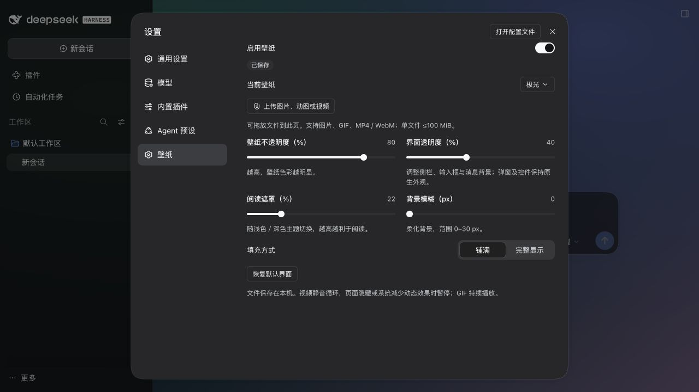

# DeepSeek Harness 动态壁纸

[](https://www.npmjs.com/package/dsh-harness-wallpaper)


用图片、动图或视频装饰 Harness 窗口。入口：**设置 → 壁纸**。



## 功能

- 上传或拖入图片、GIF / 动态 WebP / APNG、MP4 / WebM，视频静音循环、支持暂停。
- 不透明度、界面透明度、阅读遮罩、模糊均通过滑块拖拽调节，实时预览、自动保存。
- 复用 Harness 原生组件，支持浅色 / 深色主题、铺满 / 完整显示及四款内置壁纸。
- 通过 Agent 对话导入、切换壁纸或调整参数，修改实时同步到已连接窗口。

## Agent 对话

安装 **0.3.0 或更新版本**并重启后，直接在 Harness 对话中提出要求，无需手动调用工具：

| 操作           | 对话示例                                                    |
| -------------- | ----------------------------------------------------------- |
| 导入并应用     | 把 `/绝对路径/视频.mp4` 设为壁纸。                          |
| 查看与切换     | 列出我的壁纸，再切换到极光。                                |
| 切回上传的媒体 | 切换到我上传的 `海边.gif`。                                 |
| 调整参数       | 壁纸不透明度 50%、界面透明度 60%、阅读遮罩 20%、模糊 8 px。 |
| 显示与播放     | 完整显示壁纸，并暂停视频。                                  |
| 关闭           | 关闭壁纸。                                                  |

修改自动保存，并实时同步到已连接窗口和设置页，无需刷新；未指定的参数保持原值。不透明度、界面透明度和遮罩范围为 0–100%，模糊为 0–30 px；暂停仅适用于视频，GIF 无法暂停。

Agent 可使用 `wallpaper_list` 查询、`wallpaper_import` 导入、`wallpaper_switch` 切换、`wallpaper_set` 调整。导入文件需 Agent 可读取；相对路径基于会话当前目录，Web 版使用服务器文件路径，不支持直接导入网络 URL。

## 安装

适配 **Harness 0.2.1-rc.2**。从 [npm](https://www.npmjs.com/package/dsh-harness-wallpaper) 安装：

```sh
# 桌面版
dsh plugin --profile desktop add dsh-harness-wallpaper

# Web 版：在服务端安装
dsh plugin --profile web add dsh-harness-wallpaper
```

安装或更新后重启应用 / Web 服务，进入 **设置 → 壁纸**。也可在插件页选择本地 `.tgz` 安装包。

## 支持与限制

- **macOS 桌面版、Web 版已实测；Windows / Linux 尚未实机验证。** 已提供三系统 × Node.js 22 / 24 的 CI 配置，需在仓库运行后确认结果。
- 只装饰应用内部背景，不改变操作系统窗口透明度。弹窗、菜单及控件保留原生样式。
- 单文件 ≤100 MiB，最多 20 个，总容量 ≤500 MiB。文件保存在当前 profile 的 `dsh-harness-wallpaper/` 目录；Web 版保存在服务器。
- 视频解码取决于 Harness / 浏览器，不转码。页面隐藏或系统减少动态效果时暂停视频；GIF 持续播放。大文件会增加内存占用。

## 开发与发布

```sh
pnpm install --frozen-lockfile
pnpm check                # 格式、类型、测试、构建和包内容检查
pnpm release --dry-run    # 校验并预览 npm 包
pnpm release              # 浏览器登录 npm 后校验、构建并发布
```

以上命令在源码项目中执行。发布前更新 `package.json` 的 `version`；npm 包只包含编译产物、运行配置、图标、语言文件和使用文档。

[MIT](./LICENSE)
